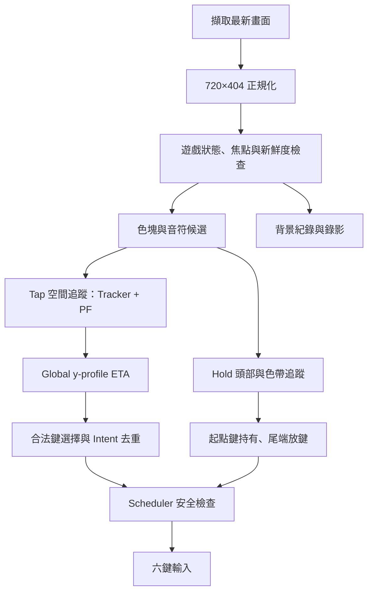

# Assist 架構

擷取使用單槽最新影格，不堆積 FIFO。CSV 與 Overlay／影片編碼在背景執行，忙碌的診斷輸出不應阻塞控制。

Tap ETA 由 Global timing 決定，PF 不參與 Tap ETA。Hold 沿曲線維持起點鍵，正常放鍵依尾端期限；安全條件失效時仍可立即放鍵。成功放鍵後，Scheduler 通知 Engine 清理持有／預約狀態，已消耗的事件不會自動重按。

所有輸入都保留手動 Arm、PLAYING、Focus、ROI、新鮮度、合法鍵與衝突檢查。核心共用的追蹤、幾何、診斷模組仍是執行依賴，不能僅依檔名刪除。
