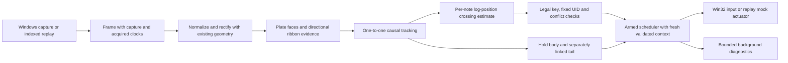

# Rebuilt runtime architecture

The rebuilt runtime is a 14-module implementation in `src/`. It provides a single causal path from captured frame to scheduled input. It has no frozen legacy runtime dependencies; it reuses the verified Win32 operations and the existing geometry only. The old runtime is not part of the rebuilt path.

## Module responsibilities

| `src/` module | Responsibility |
| --- | --- |
| `__init__.py` | Package marker |
| `model.py` | Frame, Detection, Note and geometry representation |
| `recordings.py` | Indexed frame decoding and complete human key interval normalization; offline only |
| `capture.py`, `windows.py` | Latest-frame capture and Windows focus, hotkey and scan-code input |
| `perception.py` | Rectified plate-face and directional-ribbon evidence |
| `tracking.py` | One-to-one cap association, observed-motion confirmation, note identity and Hold tail ownership |
| `timing.py` | Robust fit to real observation timestamps and calibrated visual uncertainty |
| `engine.py` | Shared perception, planning and Hold lifecycle for replay and live |
| `scheduler.py` | Immutable key/kind, bounded deadline amendments, input and release safety |
| `diagnostics.py` | Bounded action queue and replaceable display/recording work off the input thread |
| `replay.py`, `evaluation.py` | Causal mock replay and offline reference comparison; reference labels never enter Active |
| `live.py` | Runtime wiring and failure cleanup |

## Perception and tracking

Perception detects horizontal colored plate faces using paired bright horizontal edges and face fill. It joins horizontally split fragments when the gap is bright and the face heights or bevels align, including partial bevel fragments. A dark gap between adjacent chord notes is preserved. Narrow plate/bevel shadow bands are consolidated, followed by duplicate suppression **after all unions** so a retained fragment cannot produce a second track and action. Directional ribbon evidence is followed locally for Hold heads, bodies and tails.

Track identities are causal and frame-local evidence is not treated as persistent identity. In particular, connected-component IDs are meaningful only within the frame that produced them; equal numeric IDs across frames do not establish a tail link. Tail ownership is unique, and ambiguous links remain unresolved.

## Timing and action planning

Capture start, acquisition completion and processing/action time remain separate monotonic clocks. A frame is unavailable until acquired. The timing model fits log-position motion per note from real capture timestamps and uses only observations available at the current frame. A dropout may reduce remaining ETA; it does not move the predicted absolute crossing to `now`.

The modeled visual target is the plate's leading edge crossing the configured hit line. The successful-operation reference offset is derived from manual key-downs relative to that visible crossing; it is an operation offset, not a judgment-center estimate. The target is never described as the game's ideal judgment center. Timing values and their evidence limits are documented in [ground truth](REBUILD_GROUND_TRUTH.md).

A new action requires confirmed movement, stable legal key coverage, a ready timing estimate and uncertainty at or below 40 ms. The selected key and action kind stay fixed after scheduling. Same-key overlaps conflict; independent simultaneous notes retain separate actions. A consumed UID cannot fire again. Rebuilt note IDs are not assumed to identify new physical notes automatically.

A Hold keeps its starting key down while the body is followed near the lower lane region and a separate tail endpoint is tracked. A reliably observed full tail crossing can release immediately. A ready tail prediction schedules release at crossing plus its measured uncertainty and calibrated guard. Color disappearance alone is not a tail crossing. The nine-second maximum Hold is an emergency safety release, logged as `hold_hard_timeout`; it is safety-censored and is not evidence of a successful tail endpoint. The bound covers the visually verified 8.854-second REF7 J:000001 Hold. Occluded and intersecting ribbons remain a limitation.

## Safety and latency

Input starts OFF. Arming uses Ctrl+Shift+Alt+Q and waits for modifier release. Esc/F12, focus loss, invalid ROI or game state, capture/processing errors and diagnostics failure release input. Only S, D, F, J, K and L are legal. The current scheduler limits remain 60 ms capture freshness, 40 ms timing uncertainty and 15 ms maximum lateness. Only the user's arm latch may wait up to 200 ms for fresh context; a released Hold never restarts automatically.

An in-flight frame cannot authorize a key-down. An already committed action may fire during another frame's processing only while the last fully validated context is within 60 ms and focus/modifier checks still pass. The input thread uses bounded work; CSV and video encoding run in background diagnostics, with critical action loss failing closed.

Replay uses a mock actuator and does not establish Windows or game delivery. Actual `SendInput` acceptance, device transfer and game judgment have not been verified. The capture-to-acquired interval in the reference data is typically 18–20 ms; actual display exposure inside that interval is unknown, and transfer of timing behavior to another live capture backend is unverified. Actual game accuracy remains **UNVERIFIED**.

## Recovered physical identity

A late-created Tap fragment is consolidated only when the current complete face contains its predecessor's fragment, its motion agrees, and at least three earlier real observations establish the same complete span. Independent current faces, different note kinds/colors and full consecutive notes are not merged by time proximity. The original committed key/deadline is retained and normal bounded amendments still apply. If the recovered UID already sent an actuator down, only the unused original reservation is retired. Canceled/expired UIDs are distinguished from actually sent UIDs; neither means a game hit. Alias and canonical IDs are recorded for audit.

Overlay rectangles identify only observations from that exact frame. Stale stored boxes are not drawn as current notes; fresh tails use a distinct color and HELD displays actual scheduler-held keys. Source images stay clean.
