# V8.5 Early Detection and Persistent Identity

## Runtime boundary

V8.5 is an offline provider selected by the Replay tools. `src/live.py` still constructs the Legacy `Engine` and Legacy `Perception`; this design does not change that default. A Replay frame flows through:

```mermaid
flowchart LR
  F[Indexed frame and capture time] --> N[Geometry.normalize]
  N --> G[GameGate]
  G -->|playing, focused, ROI valid| P[EarlyPixelProvider]
  P --> R[Rectify once]
  R --> S[Current-frame pixel segmentation]
  S --> A[Evidence preserving adapter]
  A --> T[Tracker: hard gates + global one-to-one assignment]
  T --> E[Engine: identity, timing, eligibility]
  E --> Q[Existing Scheduler safety gates]
  Q --> M[MockActuator in offline replay]
```

Capture timestamps from `live_video_index.csv` remain the motion clock. Acquired timestamps validate order and replay cost. Human key events are only read after inference when calculating the auxiliary proximity diagnostic. The provider never reads a future frame and never paints predicted pixels into a mask.

## Birth candidate and immutable origin

The provider segments the complete geometry lane area from each current rectified frame. The current pixel classes include cyan/yellow panels, green/yellow/neutral connected ribbons, and bright low-saturation neutral panels. A neutral panel is retained in `UNKNOWN` with positive shape/fill evidence until motion and type evidence are repeated. A yellow Hold is classified from its observed connected ribbon and endpoint plate; yellow alone never means Hold.

The current birth-zone label is a provisional geometric upper half, from `Geometry.top_y` through the midpoint to the hit line. A four-run pixel-candidate audit records per-run birth-y and confirmation distributions. Because those detections are not human-reviewed physical notes, the audit does not claim this boundary is the earliest true-note boundary; Active eligibility remains unavailable until a reviewed set supports it. The boundary is metadata and an occlusion-permission prerequisite, not permission to press.

On the first real observation, `BirthIdentity` freezes timestamp, rectified box, normalized lane span, color, type hint, pixel evidence, panel quality, and zone membership. Later prediction and occlusion do not update this record or `last_seen`. Ordinary confirmation still needs real forward movement, at least 45ms of indexed time, and at least 5 rectified pixels. V8.5 permits two observations only when both carry full-face evidence and the timestamp and motion thresholds are met; weak/pending and neutral candidates retain the three-observation path.

`TYPE_PENDING` remains non-executable. A repeated full face can confirm Tap; a Hold needs repeated full heads connected to a real ribbon. The existing Timing and Scheduler requirements still determine whether any confirmed note can be scheduled.

## Association and visibility states

Tracker builds edges only after its existing time, color/role, motion, lane-span, and endpoint gates pass. It solves a global one-to-one assignment with one private unmatched option per old cap. A new observation is never assigned to two caps. An unassigned detection that competes with an existing identity is left ambiguous; close competing edges are rejected rather than arbitrarily switching owners or creating another note.

Track identity and visibility are separate fields:

| State | Meaning | May create a new action? |
|---|---|---|
| `CANDIDATE` | Real pixels exist, but motion/type is incomplete. | No |
| `CONFIRMED_VISIBLE` | A confirmed identity has a current observation. | Only through existing Engine/Timing gates |
| `CONFIRMED_OCCLUDED` | Confirmed identity missing for at most 140ms; `last_seen` remains the last observed timestamp. | Tap only if the narrower 120ms V85 rule below passes |
| `AMBIGUOUS_ASSOCIATION` | Competing owners or a gap beyond the short occlusion window. | No new action |
| `COMMITTED` | Scheduler has accepted a reservation or key is held. | Existing reservation only |
| `CONSUMED` | Mock key-down was issued or note is done. | No duplicate action |

V85 Tap occlusion can pass the face-visibility gate only for a confirmed, kind-locked birth-zone identity with a previously verified full face no older than 120ms. Timing still uses observed history, must return `ready` with uncertainty at most 40ms, and must yield a future press within the existing 300ms commit horizon. Otherwise the decision remains a distinct `confirmed_tap_observation_lost`, `tap_face_not_visible`, `stale_observation`, or Timing reason. No inferred sample advances `last_seen`.

## Hold endpoint ownership and release

Head and tail remain different cap observations. The segmentation masks separate head, continuous body, and tail pixels only when they occur in the current frame; each component carries its evidence and source frame. Tail association retains the existing connected-color path and `terminal_owner_uid` ownership checks. The Engine reports `TAIL_OCCLUDED` when there are no current owned endpoint pixels.

For an already held Hold, a new release-time update requires a unique tail owner and a reliable endpoint observation no older than 60ms. Without that evidence no release deadline is extended or invented; an already valid Scheduler deadline remains subject to its existing freeze and update limits, and the Scheduler hard Hold timeout remains the final bound. A head alone never determines Hold duration.

## Safety boundary

`src/scheduler.py` and `src/live.py` are unchanged. Arm, focus, ROI, 60ms capture freshness, 15ms lateness, six-key validation, same-key conflict, ESC/F12, freeze/update bounds, and the 0.5–9s Hold timeout remain the existing authority. V8.5 cannot bypass an Engine gate or Scheduler rejection, and the Live default remains Legacy pending reviewed visual and repeated measured-time acceptance.
